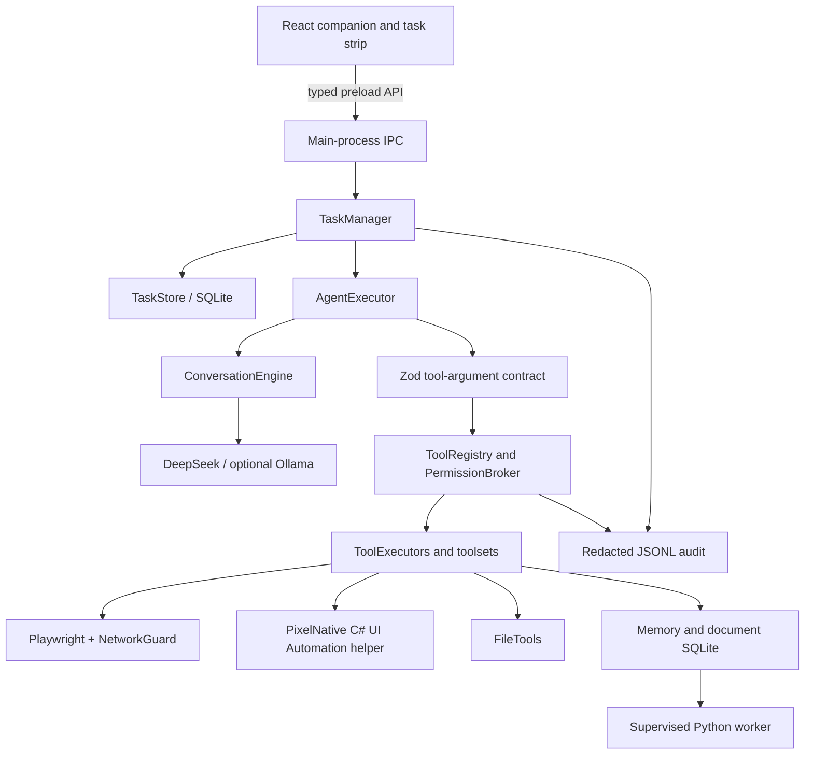

# Pixel agent runtime

Pixel remains a modular TypeScript monolith in Electron. Main-process code owns policy, privileged tools and durable task state; workers own specialized work. The renderer can request actions through a typed, allow-listed bridge but does not receive Node or unrestricted OS access.

## Current component graph

## One task today

1. `AgentExecutor.run` accepts one active request, creates a unique task id, records a sanitized request, project id and bounded budgets, and persists the initial snapshot.
2. `buildAgentMessages` assembles the trusted system prompt, conversation context and user request. Tool and retrieved content is framed as untrusted data.
3. The model may return a normal response or tool calls. The executor parses arguments and `ToolRegistry.validateArgs` checks them against the declared JSON-schema subset using Zod. Unsupported schemas fail closed.
4. `ToolRegistry.evaluate` checks mode, emergency stop, tool risk and existing target-scoped grants. `PermissionBroker` emits a request with an id, exact action, target and risk. A stale response id is ignored.
5. At approval and execution boundaries, the task records a checkpoint. The corresponding tool runs through the executor with a deadline and `AbortSignal` where supported.
6. The result is bounded before entering the next model turn. State-changing success either supplies verification evidence or is added to `pendingVerifications`. `browser_verify` checks browser actions; file, memory and document tools perform read-back checks. Native UIA invocation stores an explicit present/absent postcondition and is cleared only by a matching `verify_ui_state` observation.
7. A task with unresolved state changes finishes as `blocked` and says what remains unverified. Otherwise it ends completed, failed or cancelled. The sanitized final response and current state are persisted.
8. `request_human_takeover` pauses a task and waits for a user action. Continue only records acknowledgement; the agent must make a fresh allowed observation before any later mutation.

The plan is currently the sequence of model-proposed calls. There is no separate structured plan object or independent planner approval stage.

## Experience Polish 5.0 file-operation subset

`src/main/files/toolset.ts` retains the existing list/read/write tools and adds
bounded `file_search`, `file_metadata`, one-level `directory_create`,
`file_copy` and `file_rename`. Search is capped by depth and entry count,
skips hidden/sensitive/symlink entries, and returns metadata rather than file
contents. The new operations are constrained to the user's home scope, use
the existing approval gateway, avoid overwrite, and verify destination
metadata/content before reporting success. Rename copies exclusively and
verifies the destination before source deletion; a failed copy verification
leaves the source intact. Clipboard orchestration and additional unrestricted
application-control interfaces were not added in this checkpoint.

## Experience 5.1 board and policy boundary

`PixelBoard` is currently a renderer-owned Workspace vector editor. It supports
bounded scene objects, local profile draft recovery, explicit `.pixelboard`
save/open and SVG/PNG downloads. The scene is not an agent tool and does not
write through the main process, annotate another application's window, or
provide PDF/screenshot import. The separate desktop guidance overlay remains
passive and UIA-bound.

The requested four-tier consequence classifier and automatic Hybrid/Agent
approval matrix are not implemented. Tool authorization still follows
`ToolDefinition.requiresApproval`, `changesState`, mode restrictions, and
explicit once/session grants. Reuse remains limited by the existing grant
scope rules; a new Agent screen-observation session grant has not been added.
No policy change in this checkpoint turns observation or computer control into
silent background access.

## Durable state and restart behavior

SQLite migration 6 includes task snapshots/events, project memories, versioned skills and durable routine occurrences. Each task snapshot is Zod-validated, written transactionally with a compact status/step event, and redacted before storage. A malformed task row is skipped rather than preventing other rows from loading.

When Pixel starts, any previously active or paused task becomes `paused` with a recovery note. Pixel drops its old approval and call stack and does not repeat the last step. The user must inspect the task and issue a new request. This is safe recovery, not continuation of the same execution.

Task snapshots preserve a sanitized request and result, step metadata, budget counters, approval ids, evidence, checkpoint and pending verification references. Approval decisions themselves and model conversation internals are not persisted as resumable state. Task events are compact; the full audit stream remains in JSONL.

## Cancellation and ownership

- A single `AgentExecutor` refuses a second overlapping model task.
- Pause is honored at model and tool safe points. A pause made while an approval card is open is checked again after approval and before the action.
- Cancel aborts the model turn, rejects pending approvals and signals the current tool. Voice and Python worker calls can be stopped; child processes are terminated as a process tree on Windows. Aborting a UIA request terminates its small helper process because a blocked COM call may not honor cooperative cancellation.
- Browser actions share a session and close it during cancellation/shutdown. Actions already completed on a website or in Windows cannot be rolled back.
- The native C# helper is attached to `ToolExecutors`. It observes the foreground title and bounded UIA name/AutomationId matches, and it can invoke only one exact, unique, enabled `InvokePattern` element in the same foreground window named in the approval. Every invocation includes an expected exact visible UIA control state (`present` or `absent`); the helper confirms that state did not already hold before activation. `verify_ui_state` checks the postcondition in the same exact foreground window. Incomplete UIA trees fail closed. The helper does not type or click by coordinates.
- `DesktopInputLease` serializes `type_text` and `invoke_ui_element`. Text entry requires an expected window title and checks it inside the Windows input process immediately before sending. A focus change can still race after that check.
- The optional cursor companion uses bounded shared spring and work-area placement functions in an independent 36 DIP transparent, non-focusable, click-through BrowserWindow; its pointer artwork is 28 DIP. It continues across Workspace and Island state, is hidden while Pixel Settings is visible or the session is locked/suspended, and snaps to the current pointer on resume. It does not use desktop input or screen capture.

## Screen observation and visual guidance

- `analyze_screen` reuses the screen permission path and returns capture identity, time, target bounds, display ID, scale and actual pixel dimensions. Window capture uses the native helper's exact opaque window reference; display/region capture correlates by Electron display ID. Regions use global virtual-desktop DIP and cross-display or stale-layout requests fail instead of guessing.
- `find_ui_elements` returns accessibility-backed controls with source and observation time. Vision descriptions are labeled as model interpretation, not UIA verification. Empty vision output and failed capture are errors. A provider without image support returns unavailable rather than fabricated analysis.
- `screen_highlight_control` requires a complete selected-window identity and one exact, unique UI Automation name or AutomationId. It draws only the current accessible control bounds in a separate, transparent, sandboxed, passive window. The user must approve the high-risk guidance request. The tool never clicks or types; `screen_clear_annotations` is narrowly scoped and safe.
- The overlay repeatedly validates the target, foreground state and control bounds, expires within 3–30 seconds and clears on stale targets, lock and emergency stop. It receives a narrow typed update subscription only; it has no native handle, unrestricted IPC or window-creation API.
- Unit/build evidence is recorded in `PROGRESS.md`. The native foreground integration currently fails in this environment before capture with `The observed window or process is no longer available`; the real Pixel GUI and annotation workflow remain unverified until target-laptop acceptance passes.

## Runtime ceilings

The executor caps a request at eight model/tool turns, a five-minute wall clock and 30 seconds per tool. The task carries a 32,000-token estimate. Token accounting is approximate, and retries are not currently enabled. Tool output is clipped before model reuse. These are local execution bounds, not a provider billing guarantee.

## Known runtime gaps

- No separately persisted plan, `ready`, `verifying` or `recovering` state.
- No automatic continuation after process restart; no automatic retry of an uncertain external action.
- No uniform observation/postcondition contract for every tool. UIA postconditions cover only exact visible accessible control presence or absence in the same foreground window; they cannot verify text values, file contents, or a newly titled window.
- Task retention/pruning is not implemented; the renderer currently asks for recent task records.
- Specialist definitions/coordinator are still not model-backed or invoked from the live task flow. Skills/routines start a normal task with a restricted tool allowlist; no independent specialist loop exists.
- Skills are reviewed and versioned, but there is no demonstration recorder or deterministic live semantic replay engine. Routine runs remain model-mediated.
- Full IPC and UI behavior needs a normal Windows GUI test. This Codex environment cannot initialize Electron's Chromium GUI.
