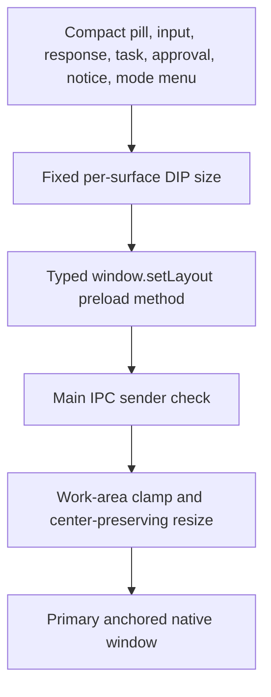

# Pixel UI architecture

Updated: 2026-11-18

## Companion panel layout and Dynamic Island (Interaction Engine 3.0)

The companion is one transparent Electron window containing one renderer panel
stack. The renderer does not create a full-screen overlay, and panel components
do not resize the native window independently.

The earlier clipping had two direct causes: `ModeSwitcher` was mounted by both
`App` and `InputBar`, and the native active window stayed at a fixed compact
height. A React z-index cannot escape the native BrowserWindow bounds. The
selector now has one mount point. Geometry is fixed per deliberate presentation
surface so a changing response body cannot resize the native window.

`usePresentationLayout` reports one bounded size when the deliberate surface
changes: a 144×52 DIP idle window containing a 138×38 visible pill, a 480×190
input panel, a 480×460 response panel, or a 480×320 task panel. The main process
clamps the requested size to the selected display. Response and transcript
content scroll inside bounded renderer panels; token updates never become
native geometry updates. The response panel preserves the user's scroll position
when they have scrolled away from the bottom.

`src/shared/dynamicIsland.ts` owns hover, click-pinned, background, response,
recording and approval presentation states. Hover waits 140 ms, leaving grants
950 ms to return, and an idle click-pinned panel closes after 4.5 seconds only
when there is no pointer interaction, draft, task, recording or approval. A
manual close changes presentation only; it does not clear draft text, history,
work or pending approvals. Runtime work remains in the existing conversation and
task services.

The preload exposes only `window.setLayout(surface, {width, height})`; it does
not expose Electron or Node APIs. The main process accepts this message only
from the companion window's `webContents`. `fitPresentationSize` caps width at
520 logical pixels and caps height to the selected display work area. Electron
display and renderer dimensions are both handled as logical pixels (DIP),
including negative multi-monitor origins.

The current mode selector is rendered once, inside `InputBar`. It uses menu
radio semantics, supports arrow/Home/End navigation, closes on Escape, an
in-window outside pointer press, or native window focus loss, and returns focus
to its trigger after Escape or selection. Escape then dismisses a pending mode
confirmation or transient notice before collapsing the companion. It does not
silently answer a pending permission request.

## Pinned bar and cursor companion (Checkpoint 2)

The primary transparent BrowserWindow stays horizontally centered on its
selected display work area and 10–14 logical pixels below that work area's top.
Renderer-measured layouts resize around the same center. The main window is
not draggable, and no renderer IPC can set arbitrary X/Y coordinates. Pixel
persists the selected Electron display id and top offset. Legacy coordinates
are used only once to infer their old display and are then cleared. If a saved
display is unavailable, Pixel selects the primary display and persists that
fallback. Display-add, removal and metrics events reapply the anchor.

When enabled, the cursor companion is a separate 36×36 DIP transparent
BrowserWindow containing 28×28 DIP pointer-character artwork. It uses the same
sandboxed preload settings, `focusable: false`, `movable: false`, the ordinary
`floating` always-on-top level and native click-through. The pointer hotspot is
the placement anchor; its default visible gap is 8×8 DIP, capped at 12 DIP.
Placement uses the current display's work area and flips horizontally or
vertically near an edge with 8 DIP hysteresis. All positions use Electron's
global logical-pixel coordinate space.

The critically damped follower runs at 30 Hz only while the companion is
visible, bounds native-window lag to 12 DIP, and skips native position writes
while stationary. Pointer jumps of 160 DIP or more, monitor changes and pauses
of 500 ms or more snap it to the current pointer target. Reduced motion also
uses direct placement. The companion is visible only while the main Island is
compact and idle. It is hidden while a Pixel Settings/Workspace window is open,
the Island is expanded or hidden, or the session is locked/suspended. Returning
to compact mode, closing Pixel windows or resuming the session repositions it
at the current pointer before showing it. Disabling the feature closes the
window and stops its timer. It does not capture screenshots or take a
desktop-input lease.

Settings exposes the pinned top-bar status, explicit display selection, a
10–14 px top offset and the independent cursor-companion toggle with speed,
offset and reduced-motion settings. A legacy `visualMode: "cursor"` enables the
new companion only when no explicit new preference was stored. The renderer
bridge no longer exposes arbitrary main-window position setters or getters.

## Native layout verification

Pure geometry tests cover 1366×768, 1920×1080 and 2560×1440 logical work areas,
negative monitor origins, monitor fallback, top-center stability and renderer
measurement caps. They prove calculations, not final rendered pixels, native
click-through or Electron window lifecycle. DPI, multi-monitor and cursor
overlay acceptance steps are recorded in
[`PIXEL_WINDOWS_ACCEPTANCE.md`](../validation/PIXEL_WINDOWS_ACCEPTANCE.md).

## Push-to-talk and local transcription

The global shortcut manager registers only the configured PTT chord. On
keydown, a short-lived `PixelNative` mode samples only the virtual keys in that
chord until any key is released, Pixel cancels, the helper exits, or its
20-second bound expires. It does not install a keyboard hook, retain a key
sequence, or forward keystrokes. Spawn failure, helper crash, cancellation and
timeout produce distinct terminal results; the next hold can start a fresh
watcher.

The main process creates a session id and sends a start event to the companion
renderer without showing or focusing a window. This deliberately avoids a
PowerShell/Python capability probe on keydown. The renderer requests audio-only
microphone access after that explicit gesture, displays its live level waveform
inside the compact Island, and stops tracks on release, cancellation, emergency
stop, screen lock or suspend. It records at most 20 seconds, resamples to mono
16 kHz PCM and passes a bounded WAV to the main process. No screenshot is
captured as part of voice input.

Main validates the PTT sender, session and one-shot release transition before
transcription. It accepts the audio only for the released active session and
submits a valid transcript once through the existing chat/permission path. If
Pixel is busy, stopped, has a pending approval, or cannot submit, the transcript
is returned to the draft for review. Manual microphone mode uses the same local
transcriber but never auto-submits. Both paths release the microphone lease and
discard renderer audio buffers after use.

Windows System.Speech is the built-in local recognizer when installed. The
optional faster-whisper worker is CPU/int8 and uses `local_files_only`; it
accepts only the supported English model names and never downloads a model.
Transient WAV files are deleted after recognition, including error and cancel
paths. Pixel does not log transcript text or audio. The sandboxed capability
probe reported `speechToText=false`; the full Windows test run with local
process access reported `speechToText=true` and `textToSpeech=true`, consistent
with a Windows System.Speech recognizer being available outside the sandbox.
This probe does not establish microphone access or transcription accuracy. No
speech workload, CPU, memory or latency measurement is claimed. Actual laptop
microphone and focus behavior remain manual acceptance items.

The Workspace character consumes the shared PTT/runtime events. Recording and
transcription do not open the Workspace, expand the Island or take focus from
the user's current application. The main renderer remains the single PTT audio
owner, so opening or closing Workspace cannot start a second recorder.

## Persistent conversation history

`HistoryStore` remains the storage owner. It keeps an indexed JSON record per
conversation, with a maximum of 50 records and 200 messages per conversation.
Search checks titles and the sanitized user-facing transcript; it is scoped to
the active project when one is selected. Retention evicts old record contents,
not only their index entries.

The main process owns the selected conversation id and context retrieval. A
chat IPC request can name the current id, but renderer-supplied `history` is
discarded. The main process loads only user and assistant messages, removes
reasoning, tools, images and internal metadata, redacts credential patterns,
then relies on existing bounded context assembly before contacting the model.
Tool execution records and audit entries stay in their own stores.

Streaming text is accumulated in memory and written as one user-facing
assistant outcome when the request ends. Completion, partial cancellation and
failure are recorded separately. Writes follow `privacy.persistHistory`; a
disabled setting or failed disk write keeps the conversation in the bounded
main-process session map only. Conversations cannot be opened, deleted or
cleared while a task is active. The renderer preserves optimistic messages on
IPC failure and reloads the main-owned transcript when a panel is revealed.

`RecentChatsPanel` presents Today, Yesterday, Previous days and Older groups,
with search, incremental loading, New Chat, rename and confirmed delete/clear.
Conversation switching is blocked in the UI while streaming, a task needs
attention or permission is pending, and guarded again in main IPC.

## Default-browser search

`parseExplicitSearchCommand` handles direct requests before the model call.
Normal questions are not interpreted as searches. The narrow
`browser.openSearch(query, requestText, conversationId)` bridge accepts a
bounded query, not a URL. Main constructs an HTTPS URL from a fixed Google,
Bing or DuckDuckGo host and the configured search provider, then calls
`shell.openExternal`; it never passes arbitrary renderer URLs to the OS.

Explicit user requests can open a results page in Guide mode. For model-proposed
searches, `browser_open_search` is a state-changing tool that uses the existing
permission gateway, is unavailable in Guide mode, and can be scoped to the exact
normalized query. Search success means only that Electron accepted the OS
launch request. Pixel does not claim to read or summarize results. The separate
Playwright BrowserSession remains available for approved browser automation.

## Interaction feedback

The response surface keeps reasoning collapsed and separate from the final
answer. “Spoken aloud” appears only after the native TTS call reports success.
The screenshot action requests an app-window capture, and the file-picker
control is labelled as image attachment because image uploads are the supported
formats. Failed/completed task cards dismiss after four seconds without deleting
their persisted task evidence. The Settings window is sized around its compact,
internally scrolling panel.

## Supplied P mark and monochrome surfaces

The user supplied the visual reference used for the Pixel mark. Its geometry is
hand-traced once in [`src/shared/pixelMark.json`](../../src/shared/pixelMark.json):
the approved block-built P, original color master and sparkle as a true
negative-space cutout. [`PixelMark.tsx`](../../src/renderer/components/PixelMark.tsx)
renders the same master geometry in a grayscale variation for the collapsed
Island, toolbar wordmark lockup, composer, assistant responses, Settings and
Workspace. The master JSON is not recolored or recreated. Tray and Windows app
icons continue to use that approved source asset. The cursor buddy stays a
separate monochrome pointer character; it is not the Pixel P.

The floating companion keeps a transparent native window so its rounded shape
works over the desktop; visible panels use opaque black/charcoal fills. The
shared semantic palette is documented in
[`PIXEL_DESIGN_TOKENS.md`](PIXEL_DESIGN_TOKENS.md). The Workspace and Island use
the same grayscale tokens for surfaces, selected controls and state feedback.
The companion and Workspace select the `none` system backdrop and do not apply
CSS `backdrop-filter`, Mica or Acrylic. The lower companion toolbar remains an
unboxed row; the approved P geometry and controls remain.

The last observed development launch in this environment stopped before
creating a Pixel window: Electron exited with `2147483651` (`0x80000003`) after
the native helper compiled. The monochrome surfaces, cursor placement and
GPU-enabled launch have not been visually verified here. GPU acceleration is
not disabled in production; `npm run dev:electron` retains `--disable-gpu` as a
diagnostic launch, and `npm run dev:gpu` remains available for a separate
normal-GPU check. That earlier child-process failure has not been diagnosed
and is not attributed to theme changes.

## Separate Pixel Workspace window

Workspace is a second `BrowserWindow` loading the same renderer with
`?window=workspace`. It is launched from the island, tray or configurable
`CommandOrControl+Shift+P` shortcut; it starts maximized and restores a bounded,
clamped size and position when it was last unmaximized. Native window controls
provide minimize, maximize/restore and fullscreen. Closing Workspace leaves the
tray application and island available.

Workspace does not construct another `AgentExecutor`, provider, history store,
task manager or permission broker. It uses the same typed `window.cyps` methods
and main-process services as the island. Main owns the active conversation and
broadcasts its changes and request-id-scoped stream frames to the island,
Settings and Workspace renderers. One main-process `agent.isRunning` guard
rejects a second simultaneous send. Task updates, pending/finished approval
events, emergency-stop state, settings/API-key status and project selection are
also fanned out to all three app windows, so an approval or stop in either
surface applies to the same work.

All invoke handlers first require a registered Pixel window's top-level frame
to be the configured local/dev renderer URL. Workspace window-control methods
are scoped to the Workspace sender; island geometry and click-through controls
are scoped to the island; only the Settings window can close itself. The
preload remains sandboxed, context-isolated and narrow. Links are parsed and
constrained to credential-free HTTP(S) URLs before `shell.openExternal`; no raw
`ipcRenderer`, Node APIs or agent internals are exposed.

Native restore geometry and shared-state logic have automated source/policy
tests, but native focus behavior, window restoration, stream/approval behavior
in two real Electron windows, and monitor/DPI rendering require the laptop
acceptance steps. Those are not inferred from the DOM or type checker.

## Electron references

- [BrowserWindow options](https://www.electronjs.org/docs/latest/api/browser-window) cover preload paths, context isolation, sandboxing, web security and native window behavior.
- [Electron security recommendations](https://www.electronjs.org/docs/latest/tutorial/security/) recommend keeping context isolation and sandboxing enabled and not passing untrusted content to `shell.openExternal`.
- [`shell.openExternal`](https://www.electronjs.org/docs/latest/api/shell) opens a validated external URL using the operating system's default application; Pixel constructs the URL in main from a fixed provider configuration.
