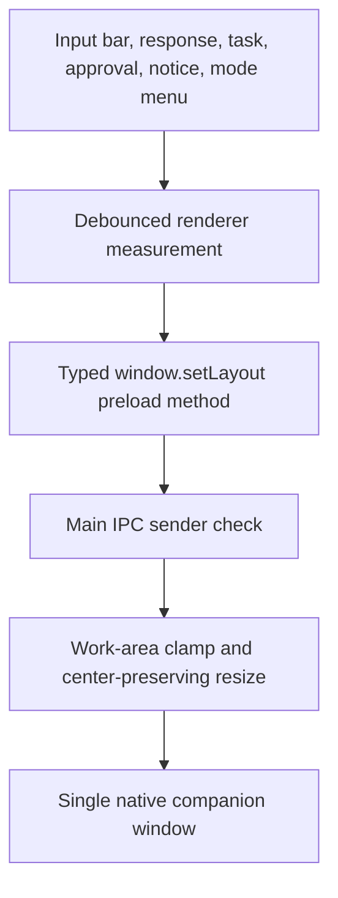

# Pixel UI architecture

Updated: 2026-11-17

## Companion panel layout (Checkpoint 1)

The companion is one transparent Electron window containing one renderer panel
stack. The renderer does not create a full-screen overlay, and panel components
do not resize the native window independently.

`usePresentationLayout` observes the root stack and marked panels. It coalesces
layout changes for 120 ms and ignores changes of three logical pixels or less.
The mode selector is in normal document flow beneath the input bar, so the
measurement includes its actual height. Response, task and approval surfaces
also participate in the same vertical stack. At the display's height limit the
native window is capped and the renderer scrolls inside its own window bounds.

The preload exposes only `window.setLayout(surface, {width, height})`; it does
not expose Electron or Node APIs. The main process accepts this message only
from the companion window's `webContents`. `fitPresentationSize` caps width at
520 logical pixels and caps height to the active display's work area minus the
top margin. `resizePresentationBounds` preserves the existing horizontal center
and keeps the window inside the work area. Electron display and renderer
dimensions are both handled as logical pixels (DIP), including negative
multi-monitor origins.

The current mode selector is rendered once, inside `InputBar`. It uses menu
radio semantics, supports arrow/Home/End navigation, closes on Escape, an
in-window outside pointer press, or native window focus loss, and returns focus
to its trigger after Escape or selection. Escape then dismisses a pending mode
confirmation or transient notice before collapsing the companion. It does not
silently answer a pending permission request.

This checkpoint retains the existing cursor presentation implementation. It
still moves the primary window while enabled; separating that follower into an
independent passive window is planned for Checkpoint 2 and must not be treated
as delivered yet.

## Native layout verification

Pure geometry tests cover 1366×768, 1920×1080 and 2560×1440 logical work areas,
negative monitor origins, center preservation, and renderer measurement caps.
They prove the requested geometry calculations, not the final pixels rendered
by Electron. Actual DPI and clipping acceptance steps are recorded in
[`PIXEL_WINDOWS_ACCEPTANCE.md`](../validation/PIXEL_WINDOWS_ACCEPTANCE.md).

## Browser search and history

Not delivered by this checkpoint. Their IPC, persistence and permission
architecture will be documented when those checkpoints are implemented.
