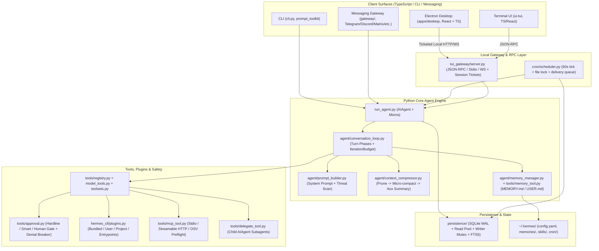

# Hermes Agent Architecture Overview

Based on `NousResearch/hermes-agent@0f602c5f`.

## High-Level System Architecture

Hermes separates **UI surfaces** (Electron Desktop, TypeScript TUI, CLI, Messaging Platforms) from a **Python-first core agent engine** coordinated through local gateways and a unified persistence layer.

## Core Architectural Principles Observed

1. **Mixin-Composed Agent Core:** `AIAgent` in `run_agent.py` stays navigable by delegating lifecycle, streaming, compression, persistence, interrupts, and turn phases to focused modules under `agent/`.
2. **Self-Registering Tool Registry with Scope Overlays:** `tools/registry.py` avoids circular imports and supports `ContextVar`-scoped session tool overlays and AST-cached discovery.
3. **Frozen Session Memory Snapshot for Prefix-Cache Stability:** `MEMORY.md` and `USER.md` enter the system prompt as a frozen snapshot at session start; mid-session writes persist to disk without mutating the prompt prefix cache.
4. **Fail-Closed Safety & Quarantine:** Corrupt SQLite stores quarantine rather than silently resetting; corrupt Electron backend ownership files quarantine rather than leaking orphan processes; explicitly empty toolset allowlists fail closed.
5. **Independent Local Gateway Ownership:** Electron Desktop connects to an independently owned local gateway via minted per-request `X-Hermes-Gateway-Ticket` grants rather than stuffing credentials into renderer state or URLs.
