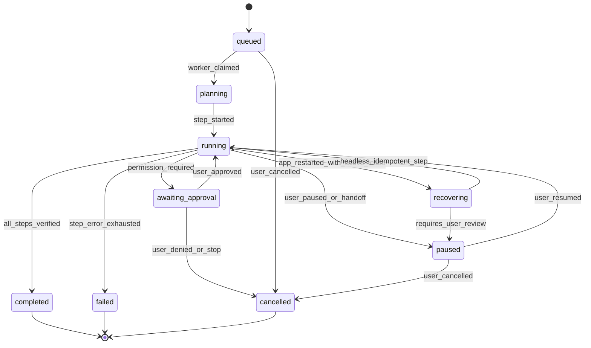

# Background Execution, Scheduling & Gateway

Source authority: `cron/scheduler.py`, `cron/jobs.py`, `cron/delivery_queue.py`, `cron/missed_runs.py`, `cron/lifecycle_guard.py`, `cron/scheduler_detached_worker.py`, `cron/scheduler_liveness.py`, `gateway/`, `tui_gateway/server.py`.

## 1. Hermes Scheduling & Background Model
- **Tick Architecture (`cron/scheduler.py`):** Gateway calls `tick()` every 60s from a background thread, serialized across processes via `~/.hermes/cron/.tick.lock` (`fcntl` on POSIX, `msvcrt` on Windows).
- **Job Persistence & Cron Expressions:** Uses `croniter==6.2.4` + `tzdata` (critical on Windows where IANA zones are absent by default) for full cron and interval schedules, persisted in JSON/SQLite with missed-run detection (`cron/missed_runs.py`), retry/unreachable-retry policies (`cron/unreachable_retry.py`), quota holds (`cron/quota_hold.py`), and incident tracking (`cron/incidents.py`).
- **Fail-Closed Toolset Allowlists:** Security fix `#82010` distinguishes an **explicitly empty toolset allowlist** (fail closed, 0 tools allowed) from an absent allowlist, and `#141468` preserves exact `mcp-<server>` scoping so a narrow job never widens into every enabled MCP server.
- **Detached Workers & Liveness:** Long jobs can execute in detached workers (`scheduler_detached_worker.py`) monitored by `scheduler_liveness.py` and `execution_identity.py`; finished sessions persist unique non-blank titles synchronously before store teardown (`_set_cron_session_title`).
- **Process Survival Distinction:** In-process background threads die when the gateway/app exits; only persisted job definitions, delivery queues (`cron/delivery_queue.py`), and detached OS workers survive restarts and are reconciled on next boot.

## 2. Proposed Pixel Durable Task State Machine (for Running Tasks)

- **Headless vs. Interactive-Desktop Split:** Pixel must tag each task `executionScope: 'headless' | 'desktop_session'`. Headless tasks (Git/GitHub, web research, document indexing, memory review) continue running while Pixel is minimized to tray; `desktop_session` tasks (Windows UIA, screen capture) automatically pause on screen lock or desktop loss.
