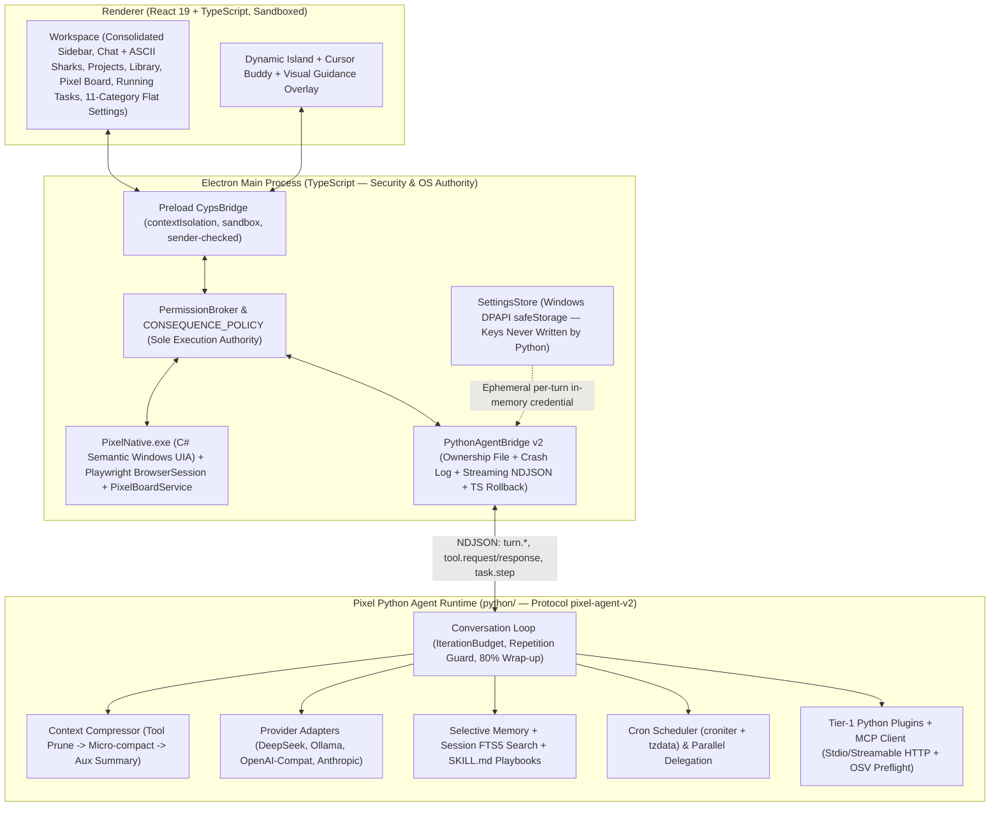

# Pixel Target Architecture (Hermes-Inspired, Python-First Core + Electron/React UI)

## Architectural Split

## Non-Negotiable Invariants
1. **Single Authorization Authority:** Electron main's `PermissionBroker` remains the **only** authority that approves, denies, or executes privileged OS/file/Git/UIA/browser actions. Python emits `tool.request` frames and waits for `tool.response` — it never bypasses `PermissionBroker`.
2. **No Secret Leakage:** DPAPI credentials stay in Electron main (`SettingsStore`) and are passed in-memory per provider request or host-pinned adapter, never written to `.env`, logs, or renderer state.
3. **Preserve Pixel Identity:** Keep Pixel's near-black matte + blue (`#4299F5`) design system, 11-category flat Settings, Pix mascot, ASCII Shark background, Pixel Board, and C# `PixelNative.exe`.
4. **Always-Available Rollback:** Feature flag `agent.runtimeEngine: 'python' | 'typescript'` allows instant fallback to the existing TypeScript `AgentExecutor` if Python is unavailable or fails health checks.
