# Tools, Toolsets & Execution Backends

Source authority: `tools/registry.py`, `model_tools.py`, `toolsets.py`, `tools/terminal_tool.py`, `tools/mcp_tool.py`, and machine-readable [TOOL_INVENTORY.json](./TOOL_INVENTORY.json).

## 1. Registration & Dispatch Pipeline

```mermaid
flowchart LR
  Mod["tools/*.py & tools/<pkg>/tool.py"] -->|registry.register at import| Reg["tools/registry.py (Global + ContextVar Session Overlay)"]
  Plg["Plugins & MCP Servers"] -->|PluginContext.register_tool / mcp_tool| Reg
  Reg -->|get_tool_definitions + check_fn + disabled_toolsets| Model["LLM Tool Schemas"]
  Model -->|tool_call| MT["model_tools.py::handle_function_call()"]
  MT --> Coerce["arg_coercion.py::coerce_tool_args()"]
  Coerce --> Guard["ToolGuardrail + tools/approval.py"]
  Guard --> Exec["Sync / Persistent Async Loop Handler"]
  Exec --> Cap["_bound_json_error_result (<= 2048 chars)"]
```

- **Self-registering AST discovery (`discover_builtin_tools`):** Scans `tools/*.py` and `tools/*/tool.py` sorted alphabetically; memoizes `(mtime_ns, size)` verdicts atomically on disk (~145 ms saved per startup).
- **Safe-worker lockdown:** When `safe_worker_enabled()` is true, discovery restricts itself to `["tools.file_tools", "tools.terminal_tool", "tools.process_registry"]` and skips plugins and writable discovery caches.
- **Toolset composition (`toolsets.py`):** `_HERMES_CORE_TOOLS` is shared across CLI and platforms; `CLIENT_SURFACE_TOOLSETS` (`project`, `desktop_ui`, `catalog`) are enabled per desktop-sourced session by `tui_gateway`, never via global env vars. Webhook sessions get a strictly narrowed `_HERMES_WEBHOOK_SAFE_TOOLS` (`web_search`, `web_extract`, `vision_analyze`, `clarify`).

## 2. Core Registered Tool Families (from `TOOL_INVENTORY.json` & `toolsets.py`)

| Toolset | Registered Tools | Backend / Execution | Side Effects | Pixel Equivalent | Gap |
| --- | --- | --- | --- | --- | --- |
| **Terminal & Process** | `terminal`, `process_manage` | `local`, `docker`, `modal`, `daytona`, `vercel_sandbox`, `ssh`, plugin backends; foreground cap `600s`; background process registry | Yes (high/critical) | None (only controlled `git_*` via `execFile`) | Missing scoped policy-controlled command runner & background process manager |
| **Files & Patch** | `read_file`, `write_file`, `patch`, `search_files` | Local/sandbox FS; `read_file` uses `firecrawl-anydoc` for PDF/Office/EPUB; `patch` supports fuzzy matching | Read / Write | `file_list`, `file_read`, `file_write`, `file_search`, `file_copy`, `file_rename`, `file_trash`, `documents_*` | Missing fuzzy `patch` tool and rich PDF/Office extraction inside `file_read` |
| **Browser** | `browser_exec`, `browser_cdp`, `browser_dialog`, `browser_vault` | Python over CDP (`browser-harness`), raw CDP, dialog handling, credential vault | Yes | Playwright `browser_*` tools (accessible targets, critical submit gate) | Pixel's Playwright tools are safer for forms; missing raw CDP/session persistence |
| **Web** | `web_search`, `web_extract`, `x_search` | Search APIs + web extraction | Read-only | `browser_open_search` (opens default browser) | Missing headless `web_search` / `web_extract` for research turns |
| **Code Execution** | `execute_code` | Sandboxed code runner + `check_execute_code_guard` | Yes | None | Deferred / optional sandboxed runner |
| **Memory & Sessions** | `memory`, `session_search` | `MEMORY.md` / `USER.md` + SQLite FTS5 cross-session search with aux summarization | Read / Write | `memory_*` SQLite store + `autoExtract.ts` | Missing `session_search` cross-chat FTS5 recall with summarization |
| **Skills** | `skills_list`, `skill_view`, `skill_manage` | `~/.hermes/skills/<skill>/SKILL.md` + `skills_guard.py` security scanner | Read / Write | SQLite `SkillStore` + task recording drafts | Pixel has structured tool-plan skills; missing Markdown procedural `SKILL.md` library |
| **Scheduling & Tasks** | `cronjob_manage`, `todo_list` | `cron/scheduler.py` (croniter + file lock) + turn-scoped todo injection | Yes | `RoutineStore` (daily local schedules) + `ProductivityTools` | Missing cron expressions, missed-run recovery, and durable queue |
| **Delegation** | `delegate_task` | Spawns isolated child `AIAgent` (leaf/orchestrator, parallel batch) | Inherited minus blocked | `SpecialistCoordinator` (4 bounded specialists) | Pixel lacks parallel batch delegation, child heartbeats, and structured output schemas |
| **Vision & Media** | `vision_analyze`, `video_analyze`, `image_generate`, `video_generate`, `text_to_speech` | Vision/media providers + Edge/ElevenLabs/OpenAI TTS | Read / Generate | `analyze_screen` (DeepSeek vision), Kokoro / Windows SAPI TTS | Media generation optional; local vision/voice already well-scoped in Pixel |
| **Desktop UI & Computer Use** | `computer_use`, `desktop_project`, `desktop_preview`, `drive_preview`, `annotate_preview`, `read_window_below`, `focus_pane`, `read_terminal`, `close_terminal` | `cua-driver` + desktop RPC | Yes | Windows C# `PixelNative.exe` semantic UIA (`invoke_ui_element`, `control_ui_element`, `screen_highlight_control`, `screen_draw_arrow`) | Pixel's Windows semantic UIA + window identity pinning is stronger on Windows; preserve it |
| **Connections, Catalog & MCP** | `manage_connections`, `manage_catalog`, dynamic `mcp-<server>` tools | `tools/mcp_tool.py` (stdio, Streamable HTTP, SSE, OSV malware preflight) | Depends on tool | Bundled `PluginStore` (GitHub plugin) | Pixel lacks dynamic MCP client connectivity and OAuth connection manager |
